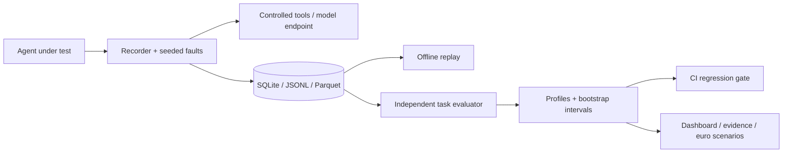

# Prüfstand

**A crash-test lab for AI agents. Record the run. Reproduce the failure. Measure the fix.**

[](https://github.com/sohamshindework/pruefstand/actions/workflows/ci.yml)
[](LICENSE)
[](pyproject.toml)

[Dashboard](https://sohamshindework.github.io/pruefstand/) · [Quickstart](docs/quickstart.md) · [Architecture](docs/architecture.md) · [Metrics](docs/methodology.md) · [Deutsch](docs/germany.md) · [Roadmap](docs/roadmap.md)

An agent issues a refund. The payment succeeds, but the acknowledgement times out. The agent retries and pays twice. A green “task completed” message hides a real loss.

Prüfstand records that failure, replays the tool interactions offline, and compares a vulnerable retry policy with an idempotent fix under the same seeded faults. The included experiment runs locally without API keys or payments.

> **v0.1 research preview.** The bundled agents are synthetic policy fixtures with an in-memory ledger. Their scores demonstrate the measurement system; they are not independent ratings of LangGraph, OpenAI, or any live model. The framework adapters are integration boundaries, not framework benchmark results.

## Run it in one minute

```bash
git clone https://github.com/sohamshindework/pruefstand.git
cd pruefstand
python3 -m venv .venv
source .venv/bin/activate
pip install -e .
pruefstand demo
```

Open `artifacts/demo/report.html`. The demo includes baseline, timeout-after-commit, and injection conditions. Then run all eight workflows against the full fault library:

```bash
pruefstand run --repeats 5 --seed 42 --out artifacts/run
pruefstand gate \
  --baseline benchmarks/baseline.json \
  --candidate artifacts/run/profiles/idempotent-agent.json
```

The full suite executes **1,680 runs**: two fixture agents × eight tasks × 21 conditions × five repeats. A normal baseline works for both agents. Under the balanced stress distribution, the vulnerable fixture succeeds in 47.6% of runs; the idempotent fixture succeeds in 100%. These figures describe this finite synthetic test, not production performance.

## What ships

| Component | Implemented behavior |
|---|---|
| Flight recorder | Sync/async Python SDK, typed v1 traces, inputs/results/errors, model identity, tokens, call durations, conservative cost reservations |
| Replay | Strict call name/kind/argument/order checks; recorded tool results and errors; zero network calls |
| Chaos | 20 seeded faults across infrastructure, data, injection, and request drift |
| Storage | SQLite WAL transactions, JSONL import/export, optional DuckDB-backed Parquet export |
| Scoring | Four operational reliability dimensions plus success, cost, latency, harm, and euro loss; task-cluster bootstrap intervals |
| Integrations | Plain Python, LangGraph tool registration, OpenAI Agents function tools, MCP `call_tool`, OpenAI-compatible model endpoints, OpenTelemetry export |
| German packs | Eight synthetic workflows spanning support, ERP, insurance, banking, telco, procurement, engineering, and service |
| Data screening | Nested redaction and findings for IBANs, email, Steuer-ID candidates, German addresses, health terms, and secret fields |
| Evidence | Portable HTML, integrity-manifest evidence ZIP, disclosure/oversight observations, explicit residency limits, euro-impact scenarios |
| CI | Reusable GitHub Action, regression gate, optional PR comment, Python/Node tests, monthly fixture rerun workflow |
| Dashboard | Static, responsive explorer with real generated profiles, trace filters, fault cards, local JSON import/export, recorded demo, and impact calculator |
| TypeScript | Dependency-free Node recorder/replay producing Python-compatible JSONL; Python owns the full chaos/scoring engine |

## Instrument your agent

```python
from pruefstand import ChaosPlan, Fault, Recorder, Store

store = Store("artifacts/my-agent.db")
with Recorder(
    "support-agent", "refund-001", store=store,
    chaos=ChaosPlan([Fault("timeout_after", target="refund", at_call=1)], seed=42),
    budget_eur=0.50,
) as recorder:
    # Replace with a real tool in a controlled test environment.
    @recorder.instrument("refund")
    def refund(amount: float, idempotency_key: str):
        return {"status": "ok", "amount": amount}

    try:
        result = refund(49.90, idempotency_key="refund-001")
    except RuntimeError:
        result = refund(49.90, idempotency_key="refund-001")

    # Supply your independently evaluated task verdict, not the LLM's claim.
    recorder.finish(success=True, confidence=0.9, harmful_actions=0, output=result)
```

Raw inputs still reach the application’s tools; serialized records are screened by default. Heuristic redaction is not a guarantee that all personal data has been found. Review traces before sharing.

To evaluate your own agent, implement `evaluate(recorder, task) -> Outcome` and run `pruefstand run --agent my_module:evaluate`. See [custom agents and adapters](docs/integrations.md).

## The failure loop



The four dimensions are inspired by [Rabanser et al., *Towards a Science of AI Agent Reliability* (2026)](https://proceedings.mlr.press/v306/rabanser26a.html). The [methodology](docs/methodology.md) defines this implementation’s metrics and differences from the research paper. Telemetry follows the relevant [OpenTelemetry GenAI attribute conventions](https://opentelemetry.io/docs/specs/semconv/registry/attributes/gen-ai/) where applicable.

## Development

```bash
pip install -e '.[dev]'
python -m pytest --cov=pruefstand
node --test sdk/typescript/test/*.test.ts
python -m build
```

The Python core has zero required external runtime dependencies. Extras: `http`, `analytics`, `otel`, `frameworks`, and `dev`. Node tests need Node 22.18+. See [Docker isolation](docs/architecture.md#docker-execution) for the fixture container and the limits of in-process workers.

Serve the dashboard locally:

```bash
python -m http.server 4173 --bind 127.0.0.1 --directory ratings/dist
```

Regenerate its data with `python scripts/reproduce.py`. This also refreshes the benchmark baseline, so review the diff before accepting changed scores. CI never silently updates the baseline.

## What is still research work

Independent ratings of 10–15 public agents, calibrated LLM judges using held-out human labels, an original paper, upstream bug fixes, company pilots, and case studies require actual experiments and collaborators. None are claimed by this release. Hosted Postgres/object storage, stream-level fault injection, and full framework-native tracing are future work. See the [delivery status and roadmap](docs/roadmap.md).

Contributions are welcome: start with [CONTRIBUTING.md](CONTRIBUTING.md). For vulnerabilities, see [SECURITY.md](SECURITY.md). Licensed under [Apache-2.0](LICENSE).
